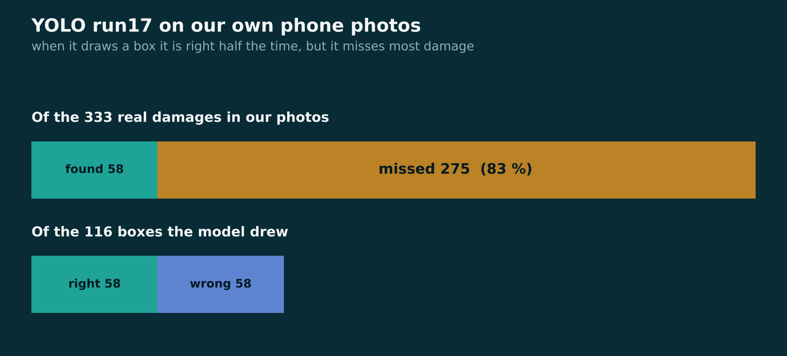
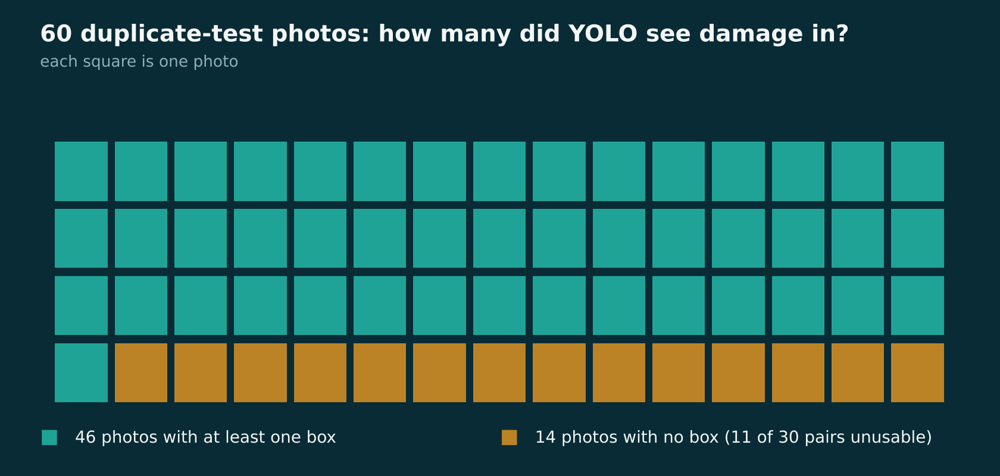
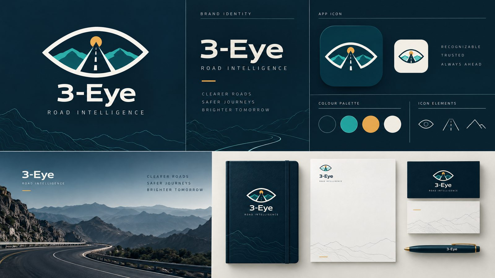
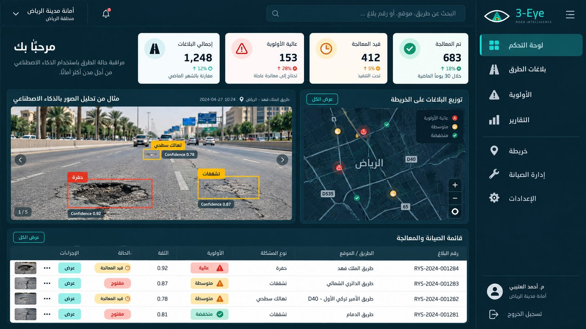
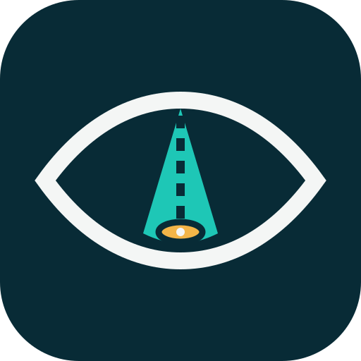

<p align="center">
  
</p>

<p align="center">
  <b>Detect road damage, score its priority, and catch duplicate reports, from one photo.</b><br>
  <sub>Olo Academy AIEP capstone · Track A: RoadScan</sub>
</p>

<p align="center">
  <a href="https://3eye-roadscan.streamlit.app"></a>
</p>

<p align="center">
  
  
  
  
  
</p>

---

## At a glance

| 🎯 Finds | 🧭 Ranks | 🔁 De-duplicates | 🔒 Protects |
|---|---|---|---|
| 4 damage types: long crack, wide crack, alligator cracking, pothole | every report gets a 0 to 100 priority score | repeated reports of the same damage | faces and licence plates are blurred before anything is shown or saved |

| Headline number | Value | Where |
|---|---|---|
| Duplicates caught with GPS (held-out test pairs) | **8 of 9**, 0 false alarms in 24 | [E5](#duplicate-finder-e5) |
| Duplicate-finder accuracy with GPS (test pairs) | **32 / 33** | [E5](#duplicate-finder-e5) |
| Detector on China development validation (mAP50-95) | **65.79 %** | [Evaluation status](#evaluation-status) |
| Detector on 4,804 US images (mAP50-95) | **49.73 %** | [Evaluation status](#evaluation-status) |
| Real damage found on our first local phone-photo test | **17 %** (it misses most) | [Detector on our own photos](#detector-on-our-own-photos) |

## Contents

1. [Team](#team)
2. [Problem and motivation](#problem-and-motivation)
3. [What the system does](#what-the-system-does)
4. [Try it](#try-it)
5. [Architecture](#architecture)
6. [Start here (documents)](#start-here)
7. [Current detector](#current-detector)
8. [Priority score](#priority-score)
9. [Results](#results)
10. [Error analysis](#error-analysis)
11. [Evaluation status](#evaluation-status)
12. [Frozen settings and rules](#frozen-settings-and-rules)
13. [Data versions and attribution](#data-versions)
14. [Limitations and future work](#limitations-and-future-work)
15. [Layout](#layout)
16. [Brand](#brand)

---

## Team

| Member | GitHub | Focus |
|---|---|---|
| Sara | [saravii7](https://github.com/saravii7) (Sara-albahesh) | Repository owner, Streamlit app, integration |
| Rimas | rimas-al-abunasser | YOLO road-damage detector (run17) |
| Fajer | fajer-alshahrani | E1 ResNet-18 baseline, priority score, duplicate finder (E5) |

## Problem and motivation

Cities receive many photos of damaged roads from residents. Two things make this hard to handle by hand:

- **Which damage should be fixed first?** A pothole and a thin crack are not equally urgent.
- **Many people report the same damage.** The same pothole can arrive as ten separate reports, which wastes the time of the repair team.

3-Eye RoadScan takes a road photo and returns the detected damage, a priority score, and a warning when the photo looks like a report that already exists.

## What the system does

1. **Detects** four kinds of damage with a YOLOv8s model: long crack (D00), wide crack (D10), alligator cracking (D20) and pothole (D40).
2. **Protects privacy.** Faces and licence plates are blurred first (`app/privacy.py`). The blur is not perfect: side faces and angled plates can be missed.
3. **Scores priority** of each report so the repair team can sort the list.
4. **Finds duplicates.** Each detected box is cropped, turned into a DINOv2 fingerprint, and compared with open reports. A match must be the **same class**, **within 30 m** (when GPS is available) and **visually similar**.
5. **Shows it all** in an Arabic-first Streamlit app for citizens and the municipality.

## Try it

**Live app:** https://3eye-roadscan.streamlit.app

**Run it yourself** (from the repository root):

```bash
git clone https://github.com/saravii7/3-EyeRoadScanProject.git
cd 3-EyeRoadScanProject

python -m venv .venv
source .venv/bin/activate              # Windows: .venv\Scripts\activate

# detector and tests
python -m pip install -r requirements.txt
python -m unittest discover -s tests -v

# the full app (extra packages: streamlit, faiss, transformers, ...)
python -m pip install -r app/requirements.txt
streamlit run app/Home.py
```

The detector weights (`run17_best_finetuned.pt`) are in the [v2-yolo release](https://github.com/saravii7/3-EyeRoadScanProject/releases/tag/v2-yolo); `artifacts/download_weights.py` is the baseline weight downloader. Dataset images are on Kaggle, not in this repository. Seed for the data samples: **42**.

## Architecture

<p align="center">
  
</p>

| Stage | What happens | Code |
|---|---|---|
| Input | Road photo, GPS read from EXIF when present | `app/utils.py` |
| Privacy | Blur faces and licence plates | `app/privacy.py` |
| Detector | YOLOv8s run17, classes D00 / D10 / D20 / D40 | `src/roadscan_detector.py` |
| Priority | Score from 0 to 100 | `src/priority.py` |
| Fingerprint | Crop each box with 10 % margin, DINOv2-small CLS token, 384-d, L2-normalised | `src/duplicates.py` |
| Duplicate finder | FAISS `IndexFlatIP` over open reports; same class + distance + similarity rule | `src/duplicates.py` |
| App | Streamlit pages for citizens and the city; pipeline in one place | `app/pipeline.py`, `app/Home.py` |

## Start here

- [Adopted model and limitations](docs/MODEL_SELECTION.md)
- [Single-image detector usage](docs/INFERENCE_USAGE.md)
- [Kaggle experiment log](docs/KAGGLE_EXPERIMENTS.md)
- [E3 augmentation results](docs/reports/E3_AUGMENTATION.md)
- [Reviewed country evaluation and errors](docs/reports/COUNTRY_ERROR_ANALYSIS.md)
- [Repository folders and file migration map](docs/REPOSITORY_STRUCTURE.md)

## Current detector

Use **run17_best_finetuned.pt**, fine-tuned YOLOv8s on the frozen **8,999-image** team sample. Confidence **0.46**, image size **640**, NMS IoU **0.7**, max_det **300**. The machine-readable settings are in [configs/model_config.json](configs/model_config.json). Do not substitute the historical original `selected_candidate.pt`.

Weights for runs 14, 16 and 17 remain in [release v2-yolo](https://github.com/saravii7/3-EyeRoadScanProject/releases/tag/v2-yolo). Baseline releases [v1-baseline](https://github.com/saravii7/3-EyeRoadScanProject/releases/tag/v1-baseline) and [v2-baseline](https://github.com/saravii7/3-EyeRoadScanProject/releases/tag/v2-baseline) remain available. The original release tag/source archive predates later confidence and folder updates; use current main for current code and paths.

```python
from src.roadscan_detector import RoadDamageDetector

detector = RoadDamageDetector('/path/to/run17_best_finetuned.pt', device='cpu')
detections = detector.detect_damage('/path/to/road.jpg')
# Each result: damage_code (D00/D10/D20/D40), bbox_xyxy in original pixels, confidence.
```

Root compatibility modules preserve existing `from roadscan_detector import ...`, `import priority`, and `import duplicates` imports. Model inference and thresholds are unchanged by the folder reorganization. The tests use fake model outputs to check the software contract; actual checkpoint checks are archived in notebooks 18/19. No real-weight inference or training is rerun merely to move folders.

For Kaggle, use the saved source/input versions listed in the [experiment log](docs/KAGGLE_EXPERIMENTS.md). Notebook `/kaggle/input` and `/kaggle/working` paths belong to Kaggle and are intentionally unchanged. The current detector notebook is [run 17](notebooks/yolo/17-roadscan-gentle-finetuning.ipynb); [run 18 v2](notebooks/yolo/18-roadscan-inference-smoke-v2-run17.ipynb) verifies integration; [run 19](notebooks/yolo/19-roadscan-confidence-selection.ipynb) freezes confidence.

## Priority score

A report's priority is a weighted sum of four things (draft v1; weights are proposals to be re-checked on real detector output):

```text
priority = 100 * (0.45*type + 0.20*size + 0.20*count + 0.15*conf)

type  = highest class weight among the boxes  (D40 pothole 1.0, D20 alligator 0.8, D10 wide crack 0.5, D00 long crack 0.4)
size  = total box area / image area / 0.25, capped at 1
count = number of boxes / 5, capped at 1
conf  = mean confidence of the boxes
```

| Score | Band in the app | Suggested action |
|---|---|---|
| 70 to 100 | 🔴 Urgent | Repair this week |
| 40 to 69 | 🟠 Schedule | Add to maintenance plan |
| 0 to 39 | 🟢 Monitor | Re-check later |

The bands are a UI proposal, not a validated cut-off. Code: [src/priority.py](src/priority.py).

## Results

### Duplicate finder (E5)

Three ways to fingerprint a damage crop were compared. Pairs were split so that **thresholds were tuned on 10 pairs and measured once on 9 different pairs** (30 pairs, 60 photos, with GPS; 11 pairs were unusable because YOLO found no box in at least one photo).

<p align="center">
  
</p>

| Method (no GPS) | AUC tuning / test | Top-1 correct, tuning / test | Top-5 correct, tuning / test |
|---|---|---|---|
| **DINOv2-small** (kept) | 0.79 / 0.79 | 7/10 and 8/9 | 10/10 and 9/9 |
| ResNet-18 (frozen ImageNet) | 0.81 / 0.81 | 8/10 and 7/9 | 10/10 and 9/9 |
| pHash | 0.74 / 0.66 | 4/10 and 6/9 | 10/10 and 9/9 |

**Reading this honestly:** DINOv2 and ResNet-18 perform about the same on this small sample, and pHash is clearly the weakest. We kept DINOv2 because it was chosen before the experiment and is already in the app, not because it won.

**What GPS adds** (test pairs: 9 duplicate pairs and 24 non-duplicate pairs):

| Setting | Duplicates caught | False alarms | Notes |
|---|---|---|---|
| GPS + 30 m + similarity ≥ 0.80 (**primary path**) | 8 of 9 | 0 of 24 | Accuracy 32/33, precision 8/8 |
| No GPS, similarity ≥ 0.80 | n/a | 12 of 24 | Too loose without distance |
| No GPS, similarity ≥ 0.92 (**fallback**) | 4 of 9 | 0 of 24 | Precision 100 %, recall about 44 % |

<p align="center">
  
</p>

GPS is the main path. The no-GPS threshold of **0.92** was chosen on the tuning pairs only, then measured once on the test pairs. It is deliberately strict: with no distance check it is better to miss a duplicate than to wrongly merge two different damages. Notebook: [notebooks/05-duplicates.ipynb](notebooks/05-duplicates.ipynb), code: [src/duplicates.py](src/duplicates.py).

### Detector on our own photos

A first check on our own phone photos (`local_test_set`) with the inference settings frozen. This set was **not** used to tune anything. *These numbers come from the team's Kaggle run and are not yet saved under `results/`.*

<p align="center">
  
</p>

| Model | mAP50 | Precision | Recall | F1 | Image macro-F1 | TP / FP / FN |
|---|---|---|---|---|---|---|
| **run17 (fine-tuned, used in the app)** | 0.262 | 0.500 | 0.174 | 0.258 | 0.502 | 58 / 58 / 275 |
| run14 (YOLO11s) | 0.321 | 0.612 | 0.123 | 0.205 | 0.417 | 41 / 26 / 292 |

<p align="center">
  
</p>

The honest summary: when the detector fires it is right about half the time, and it **misses most damage on phone photos** (recall 0.17). Large phone photos are shrunk to 640 px, which likely erases thin cracks. See [future work](#limitations-and-future-work).

## Error analysis

We looked at every mistake of the duplicate finder instead of only reporting the score.

| # | Kind of mistake | Where it happened | What it means |
|---|---|---|---|
| 1 | **Missed duplicates** | `loc26` (test): similarity 0.39 at 1.5 m. `lc2` (tuning): similarity 0.54, 31.8 m apart, just outside the 30 m radius | Same damage photographed from very different views, or a hair outside the radius |
| 2 | **False alarms without GPS** | Test pairs: different damages 243 m to 5 km apart that look alike | GPS removes all of these |
| 3 | **False alarms that GPS cannot remove** | Tuning only: `lc3`/`lc4` at 26 m (similarity 0.91 to 0.93), `lc5`/`lc6` at 3 to 5 m (0.82 to 0.92) | Nearby damages with a similar look |
| 4 | **No detection at all** | 14 of 60 photos had no YOLO box at or above 0.46, so 11 of 30 pairs could not be evaluated | The detector is the bottleneck, not the fingerprint |

<p align="center">
  
</p>

The causes above are our hypotheses from the numbers; we did not verify each one by inspecting the photos. For the detector's own errors on country data, see the [reviewed country report](docs/reports/COUNTRY_ERROR_ANALYSIS.md).

## Evaluation status

| Study | Status |
| --- | --- |
| E3: Mosaic / HSV / horizontal-flip ablation | Completed and documented; single seed, seven epochs per arm |
| Frozen country/error study | Completed; independent local part of E4 still pending |
| E2: detector size or input resolution | Pending |
| E1: baseline vs detector | Requires coordinated comparable evaluation; not claimed complete |
| E5: duplicate methods | Completed on a small set (10 tuning and 9 test pairs); see [Results](#duplicate-finder-e5) |
| Independent labeled local road test | First run done (see above); full written report pending |

China development mAP50-95 is **65.79%**, versus **49.73%** on 4,804 US images. US pothole recall at the frozen operating point is **43/135 = 31.85%**, an unresolved failure. These results do not establish local Saudi-road readiness. External pretraining overlap is unknown. Japan/India selected complements have limited class support; the Czech complement has no annotated damage boxes, so its AP/recall/F1 are **N/A**. See the reviewed report rather than treating raw evaluator zero placeholders as zero detection ability.

## Frozen settings and rules

| Decision | Value | Why |
|---|---|---|
| YOLO model | `run17_best_finetuned.pt` | Documented team choice; confidence frozen on China development validation |
| Inference settings | conf 0.46 · imgsz 640 · NMS IoU 0.7 · max_det 300 | Fixed before any local-test measurement |
| Fingerprint model | `facebook/dinov2-small`, frozen, no training | Small, fast, no labels needed |
| Crop margin | 10 % | Keeps a little road context |
| Duplicate rule | same class AND within 30 m AND similarity ≥ 0.80 | Chosen on tuning pairs |
| No-GPS fallback | similarity ≥ 0.92 | Chosen on tuning pairs only, measured once on test |

**Rules we kept to:** no tuning on the local test set or on the inspected US results; YOLO and DINOv2 stay frozen; thresholds are tuned on some pairs and measured on different pairs; no secrets in the repository; photos are not pushed to GitHub.

## Data versions

| | v1 | v2 |
| --- | --- | --- |
| Training images | 600 (200 per country) | 8,999 (Japan 4,000 / India 3,500 / Czech 1,499) |
| Validation | China MotorBike 1,977 | Same China development set |
| Sampling script | [make_sample.py](scripts/data/make_sample.py) | [make_sample_v2.py](scripts/data/make_sample_v2.py) |
| Seed | 42 | 42 |

The v2 sample was enriched for rare damage classes. Keep the original country assignments and do not randomly re-split the data. US country evaluation has now been performed with the frozen model. Independent local photos remain reserved for final testing. Historical notes in saved attempts remain records of their original experiment, not current adoption instructions.

**Data and model attribution.** RDD2022, Deeksha Arya et al., [dataset source](https://figshare.com/articles/dataset/RDD2022_The_multi-national_Road_Damage_Dataset_released_through_CRDDC_2022/21431547), CC BY 4.0. Published initialization: SreekarAditya / yolo-rdd2022-benchmark; retain publisher attribution and applicable Ultralytics terms. The team's contribution includes fine-tuning, controlled studies, threshold selection and evaluation; published initialization is not claimed as original team training.

## Limitations and future work

**Limitations**

- Small duplicate-evaluation sets (10 tuning and 9 test pairs), so differences between fingerprints are within noise.
- Detector recall on our phone photos is low (0.17); 14 of 60 duplicate-test photos produced no box.
- US pothole recall is 31.85 %; local Saudi-road readiness is not established.
- The no-GPS fallback catches fewer than half of the duplicates.
- Priority weights and bands are proposals, not validated.

**Future work (untested ideas)**

- **Detector recall.** Try a larger inference size (960 or 1280) or tiling, because thin cracks vanish when a large photo is shrunk to 640. Choose the setting on validation images, then measure the local test set **once** and report before and after.
- **Fine-tune on our own labelled photos** with a clean train/test split. Likely the largest gain, but slow.
- **More duplicate pairs** to separate DINOv2 from ResNet-18 properly.
- **Better no-GPS fallback**, for example combining several boxes per photo.

## Layout

| Folder | Contents |
| --- | --- |
| `app/` | Streamlit app (`Home.py`, pages, views, pipeline, privacy blur) |
| `notebooks/baseline/` | Baseline classifier notebooks |
| `notebooks/yolo/` | Saved YOLO training/evaluation notebooks 14–21 |
| `notebooks/05-duplicates.ipynb` | E5 duplicate-finder experiment |
| `experiments/attempts/` | Previous attempts, statuses and original saved versions |
| `src/` | Detector, priority formula and duplicate finder implementations |
| `scripts/data/` | Conversion, class counting, country splitting and sampling scripts |
| `configs/` | Adopted model settings and dataset YAML files |
| `data/manifests/` | Image filename lists; no dataset images |
| `results/run14/` through `results/run28/` | JSON metrics, CSV tables and figures grouped by run |
| `docs/` | Model choice, usage, experiment log, reports and protocols |
| `tests/` | Detector contract tests |
| `artifacts/` | Existing baseline weight downloader; release binaries stay external |
| `assets/` | README images: banner, architecture, charts, brand |

## Brand

The identity of 3-Eye: **an eye (vision), a road (infrastructure) and a gold dot (the moment damage is found and turned into a maintenance priority).**

<p align="center">
  
</p>

| Colour | Hex | Used for |
|---|---|---|
|  Deep navy | `#082B36` | backgrounds, authority |
|  Road teal | `#1EC7B6` | detections, primary actions |
|  Signal amber | `#F3B548` | attention, highlights |
|  Critical red | `#D95B55` | urgent damage |
|  Mist | `#A6BBC0` | secondary text |
|  Paper | `#F4F6F5` | light surfaces |

The app theme in `.streamlit/config.toml` uses the same navy and teal. The charts in this README use a slightly deeper teal and amber so they stay readable on the navy background.

**Design vision for the full product** (a concept mockup, *not* our working app; the numbers in it are illustrative):

<p align="center">
  
</p>

---

<p align="center">
  <br>
  <sub>Built by Sara, Rimas and Fajer · Olo Academy AIEP</sub>
</p>
