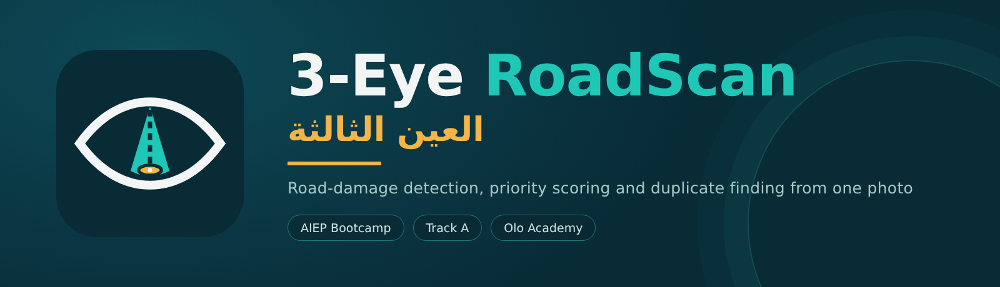
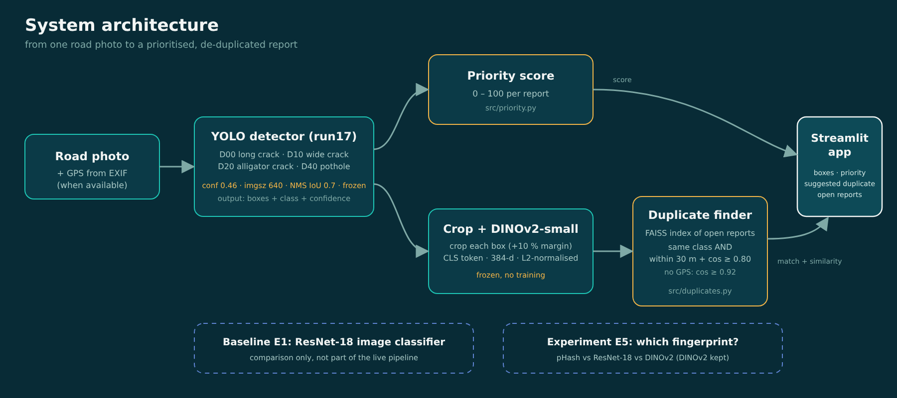
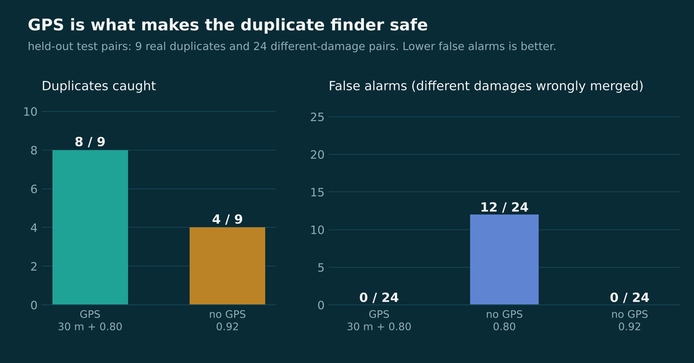
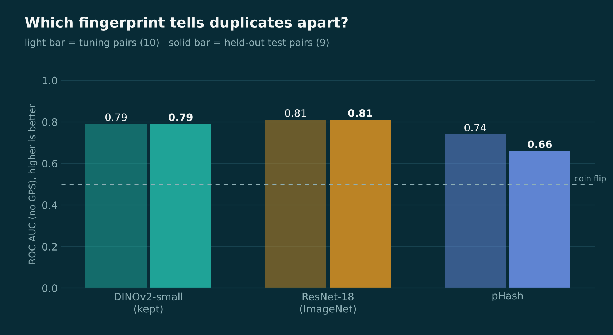
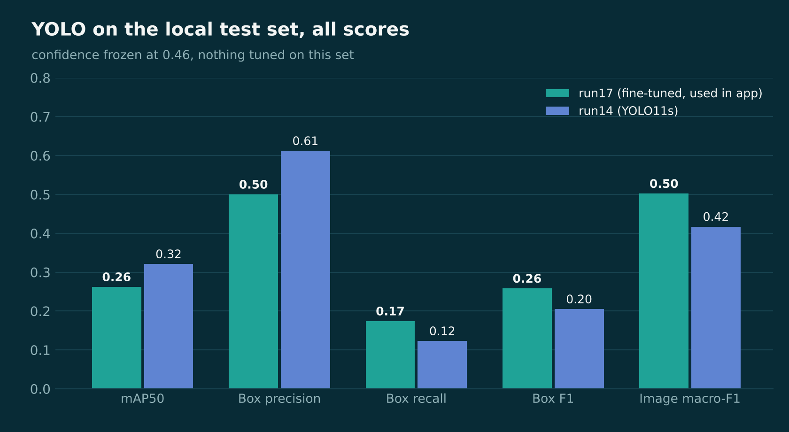

> **YOLO closeout (2026-11-01):** [Executed Python journey: runs03–27,18 charts](notebooks/yolo/28-roadscan-yolo-journey-summary.ipynb) · [Results, runtimes and source tables](results/run28/README.md) · [Closeout report](docs/reports/YOLO_CLOSEOUT.md). Run17 fine-tuned remains adopted at confidence0.46 /640. Local190-image results are inspected/reused diagnostic evidence, not a fresh independent holdout; low local recall remains unresolved.

<p align="center">
  
</p>

<p align="center">
  <b>From a phone photo of a road to a deduplicated, prioritised repair queue.</b><br>
  <sub>Olo Academy AIEP capstone · Track A: RoadScan · Team 3-Eye</sub>
</p>

<p align="center">
  <a href="https://3eye-roadscan.streamlit.app"></a>
</p>

---

## Contents

1. [Team](#team)
2. [Problem](#problem)
3. [What we built](#what-we-built)
4. [Data](#data)
5. [Damage detector](#damage-detector)
6. [Priority score](#priority-score)
7. [Duplicate finder](#duplicate-finder)
8. [Application](#application)
9. [Required experiments (E1 to E5)](#required-experiments-e1-to-e5)
10. [Evaluation](#evaluation)
11. [Error analysis](#error-analysis)
12. [Responsible AI](#responsible-ai)
13. [Live demo scenario](#live-demo-scenario)
14. [Track A checklist](#track-a-checklist)
15. [Limitations and future work](#limitations-and-future-work)
16. [Try it](#try-it)
17. [Repository layout](#repository-layout)
18. [Attribution](#attribution)

---

## Team

| Member | GitHub | Owns |
|---|---|---|
| Sarah | [saravii7](https://github.com/saravii7) | Data preparation and splits, local photos, Streamlit app, repository, integration |
| Rimas | rimas-al-abunasser | YOLO detector (runs 14 to 17), confidence threshold, E2 to E4 |
| Fajer | fajer-alshahrani | ResNet-18 baseline (E1), priority score and sensitivity check, duplicate finder (E5) |

## Problem

Municipalities receive many road-damage photos from citizens. Inspectors review them by hand, the same pothole is often reported many times, and there is no consistent way to decide what to repair first. The hard question behind the project: **will a model trained on roads in other countries work on roads in our city?**

## What we built

The four components the Brief requires, working together:

```text
Road photo → privacy blur → YOLO detector → boxes (D00 / D10 / D20 / D40)
           → priority score 0–100 → crops → DINOv2 embeddings
           → FAISS search of open reports within a GPS radius
           → "new report" or "likely duplicate of RS-0012" → priority queue in the app
```

<p align="center">
  
</p>

| Component | What it does | Code |
|---|---|---|
| 1. Damage detector | YOLOv8s (run 17) detects longitudinal crack D00, transverse crack D10, alligator crack D20, pothole D40 | `src/roadscan_detector.py` |
| 2. Priority score | Documented rule-based formula, 0 to 100 | `src/priority.py` |
| 3. Duplicate finder | DINOv2-small crop embeddings, FAISS, same class + GPS radius + tuned threshold | `src/duplicates.py` |
| 4. Maintenance app | Upload, detect, score, deduplicate, ranked queue, CPU timing | `app/` |

## Data

| Source | Use | Details |
|---|---|---|
| **RDD2022** (Arya et al., CC BY 4.0) | Training and validation | Team sample v2: **8,999 images** (Japan 4,000 · India 3,500 · Czech 1,499), seed 42, enriched for rare classes. v1 (600 images) kept as a first baseline |
| China_MotorBike (1,977 images) | Development validation | Used to choose the model and the confidence threshold |
| United_States (4,804 images) | Held-out country test | Evaluated **once** with the frozen model and threshold |
| **Local test set** (our own phone photos of local roads) | Test only, never trained on | Labelled in YOLO format; measures real domain shift |
| **Duplicate pairs** (team-built) | E5 and the duplicate threshold | Same damage photographed twice + different damages; 10 tuning pairs, 9 held-out test pairs |

**Split rule.** Data is split **by country**, never randomly, so near-identical frames from the same drive cannot appear in both training and test.

**Class imbalance.** Cracks dominate: D00 alone is 58 % of the China boxes (2,678 of 4,650) and 61 % of the US boxes (6,747 of 11,010). This is why results are reported **per class**, not only as overall mAP.

**GPS.** RDD2022 has no GPS. The duplicate experiment uses **real EXIF GPS from our own photos**; nothing is simulated.

Sampling scripts: [make_sample.py](scripts/data/make_sample.py), [make_sample_v2.py](scripts/data/make_sample_v2.py). Image lists: `data/manifests/`.

## Damage detector

| Run | Model and training | mAP50 | mAP50-95 |
|---|---|---|---|
| 14 | YOLO11s from COCO, trained by us on the 8,999-image sample | 0.227 | 0.087 |
| 15 | Published RDD2022 YOLOv8s checkpoint, no training (reference only) | 0.962 | 0.671 |
| 16 | Run 15 fine-tuned by us with the run-14 settings | 0.794 | 0.447 |
| **17** | **Run 15 gently fine-tuned by us (lr 0.0001) · adopted** | **0.959** | **0.658** |

All scores on China development validation. Run 17 starts from a published checkpoint whose training data may overlap China, so these numbers are optimistic; the honest tests are the US set and our local photos.

**Per class (run 17, China validation)**

| Class | AP50 | AP50-95 | Precision @0.46 | Recall @0.46 | F1 @0.46 |
|---|---|---|---|---|---|
| D00 longitudinal crack | 0.940 | 0.662 | 0.891 | 0.827 | 0.858 |
| D10 transverse crack | 0.929 | 0.604 | 0.861 | 0.793 | 0.826 |
| D20 alligator crack | 0.981 | 0.734 | 0.929 | 0.961 | 0.945 |
| D40 pothole | 0.986 | 0.632 | 0.942 | 0.966 | 0.954 |

**Confidence threshold 0.46, justified.** The rule was fixed before looking: pick the threshold with the highest mean box F1 over the four classes **while keeping pothole recall ≥ 90 %**, because a missed pothole costs more than a false alarm. Chosen on China validation only. Details: [THRESHOLD_SELECTION.md](docs/reports/THRESHOLD_SELECTION.md).

Confusion matrix and F1-vs-confidence curve: [run17_confusion_matrix.png](results/run17/run17_confusion_matrix.png), [run17_F1_curve.png](results/run17/run17_F1_curve.png).

Frozen settings: `run17_best_finetuned.pt` · conf 0.46 · imgsz 640 · NMS IoU 0.7 · max_det 300 ([configs/model_config.json](configs/model_config.json)). Weights: [release v2-yolo](https://github.com/saravii7/3-EyeRoadScanProject/releases/tag/v2-yolo).

## Priority score

Rules, not machine learning:

```text
priority = 100 × (0.45·type + 0.20·size + 0.20·count + 0.15·confidence)

type       = highest class weight in the photo: D40 pothole 1.0, D20 alligator 0.8, D10 transverse 0.5, D00 longitudinal 0.4
size       = total box area ÷ image area ÷ 0.25, capped at 1
count      = number of boxes ÷ 5, capped at 1
confidence = mean detector confidence
```

**Why these weights**

- **Type (0.45)** is the largest term: a pothole is a direct safety and vehicle-damage risk, and alligator cracking is the step before a pothole. Hairline cracks rank lowest.
- **Size (0.20)** and **count (0.20)**: larger or repeated damage needs more repair work and spreads faster.
- **Confidence (0.15)** is the smallest term so an uncertain detection cannot push a report to the top on its own.

| Score | Band | Action |
|---|---|---|
| 70 to 100 | 🔴 Urgent | Repair this week |
| 40 to 69 | 🟠 Schedule | Add to the maintenance plan |
| 0 to 39 | 🟢 Monitor | Re-check later |

**Sensitivity check.** Each weight was changed by −20 % and +20 % on three worked examples (thin crack, one pothole, five potholes): **the ranking stayed the same in every case**. The same check runs on real photos in the app (page *Priority score*). The bands are a proposal to be agreed with maintenance staff. Code: [src/priority.py](src/priority.py).

## Duplicate finder

Each detected box is cropped (10 % margin) and embedded with **frozen `facebook/dinov2-small`** (384-d CLS token, L2-normalised, cosine similarity). Open reports are stored in **FAISS** (`IndexFlatIP`) with their location. A new report is a likely duplicate when it has the **same class**, is **within 30 m**, and the similarity is **≥ 0.80**. Without GPS a stricter **0.92** is used.

Both thresholds were **tuned on the tuning pairs only** and measured **once** on different test pairs.

| Setting (test pairs: 9 duplicates, 24 non-duplicates) | Duplicates caught | False duplicates |
|---|---|---|
| GPS + 30 m + similarity ≥ 0.80 (**main path**) | 8 of 9 | 0 of 24 |
| No GPS, similarity ≥ 0.80 | n/a | 12 of 24 (too loose) |
| No GPS, similarity ≥ 0.92 (**fallback**) | 4 of 9 | 0 of 24 |

<p align="center">
  
</p>

**Cost of each mistake.** A missed duplicate wastes a crew visit; a false duplicate **hides a real report**. We therefore chose strict thresholds: it is safer to miss a duplicate than to merge two different damages. Notebook: [notebooks/05-duplicates.ipynb](notebooks/05-duplicates.ipynb).

## Application

Arabic-first Streamlit app, live at **https://3eye-roadscan.streamlit.app**.

| Section | Pages |
|---|---|
| Citizen | Home dashboard, report damage (photo → boxes, classes, confidence, priority, location, duplicate warning), my reports |
| Municipality (staff code) | Report queue sorted by priority, report details and status workflow, damage map, maintenance, analytics, system health |
| Technical (for the panel) | Full pipeline with per-step CPU timing, batch photo map with GeoJSON export, local test and error analysis, model results, priority sensitivity, about |

**CPU latency:** detection ≈ **0.19 s** per photo; full pipeline (detection, blur, priority, location, duplicate search) ≈ **2 to 3 s** per photo on CPU, shown on the *Image Analysis* page.

## Required experiments (E1 to E5)

| # | Question (from the Brief) | What we did | Result | Status |
|---|---|---|---|---|
| **E1** | Baseline classifier vs detector: what does localisation add? | ResNet-18 multi-label classifier (frozen backbone, sigmoid + BCE) vs YOLO run 17, scored the **same way** on the **same 1,977 China images**: image-level "is this damage type present?" F1 per class | Classifier macro-F1 **0.496** vs detector **0.962**. See table below | **Done** |
| **E2** | Size or resolution (640 vs 960, small vs medium): accuracy vs speed? | Run 17 evaluated at 640 and 960; run 17 re-fine-tuned at 960 (run 24); YOLO11m at 640/960 (run 25) | 960 was **worse** than 640: run 17 mAP50-95 0.658 → 0.470; re-tuned at 960 0.496. YOLO11m (from COCO) 0.101 vs YOLO11s 0.087. CPU time per photo (same machine, 2 threads): **0.16 s at 640 vs 0.31 s at 960**, about 2× slower ([script](scripts/e2_cpu_latency.py), [result](results/e2/cpu_latency.json)). 960 is slower **and** less accurate, so we kept 640 | **Done** for resolution; nano vs small only in early pilots |
| **E3** | Which augmentations help? | Mosaic / HSV / horizontal-flip ablation (run 20, one seed, 7 epochs per arm) | Removing mosaic −0.72 pp mAP50-95, flip −0.25 pp, HSV −0.05 pp; recipe kept. **Vertical flips are excluded**: they put the road upside down, which never happens in a forward-facing photo. [Report](docs/reports/E3_AUGMENTATION.md) | **Done** |
| **E4** | Cross-country generalisation: how badly does domain shift hurt? | Trained on Japan, India, Czech; tested on China (development), US (held out) and our local photos | mAP50-95 65.79 % China → 49.73 % US; US pothole recall 31.85 % (43/135). Local photos: mAP50 0.262, recall 0.174, precision 0.500. [Report](docs/reports/COUNTRY_ERROR_ANALYSIS.md) | **Done** |
| **E5** | Duplicate embeddings: pHash vs ImageNet ResNet vs DINOv2 | 10 tuning pairs, 9 held-out test pairs | See below | **Done** (small set) |

**E1 detail (China validation, 1,977 images, image-level F1 per class)**

| Class | ResNet-18 classifier | YOLO detector (run 17) | Always say "yes" (reference) |
|---|---|---|---|
| D00 longitudinal crack | 0.84 | 0.97 | 0.84 |
| D10 transverse crack | 0.57 | 0.93 | 0.54 |
| D20 alligator crack | 0.43 | 0.97 | 0.39 |
| D40 pothole | 0.15 | 0.99 | 0.15 |
| **Macro-F1** | **0.496** | **0.962** | |

**Reading:** the classifier is barely better than always saying "yes", most of all for potholes (0.15). The detector looks at each damage in its own box, so it does far better, and it also gives the location and size that the priority score needs. Caveats: the classifier's thresholds were tuned on these images (optimistic for the classifier), the detector uses a fixed 0.5; and the detector started from a published checkpoint that may have seen China images, so the gap is likely overstated. On the US test set the classifier drops to 0.362.

**E5 detail (no GPS, so only the embedding is compared)**

| Method | AUC tuning / test | Recall@1 tuning / test | Recall@5 tuning / test |
|---|---|---|---|
| **DINOv2-small** (used) | 0.79 / 0.79 | 7/10 · 8/9 | 10/10 · 9/9 |
| ResNet-18 (frozen ImageNet) | 0.81 / 0.81 | 8/10 · 7/9 | 10/10 · 9/9 |
| pHash | 0.74 / 0.66 | 4/10 · 6/9 | 10/10 · 9/9 |

<p align="center">
  
</p>

**Reading:** pHash is clearly weakest because it compares pixels and breaks when the angle or light changes. DINOv2 and ResNet-18 are about equal on this small sample; self-supervised DINOv2 features describe the texture and shape of the damage rather than a fixed ImageNet label, which suits near-duplicate retrieval, but more pairs are needed to separate the two. ROC curves are in notebook 05.

## Evaluation

| What | Metrics | Where |
|---|---|---|
| Detection | mAP@0.5, mAP@0.5:0.95, per-class AP, precision, recall, confusion matrix, F1-vs-confidence | [Damage detector](#damage-detector), `results/run17/` |
| Domain shift | mAP on China (in-distribution) vs US (held-out country) vs local photos | E4 above |
| Duplicate finder | Recall@1, Recall@5, precision and recall at the threshold, ROC | [Duplicate finder](#duplicate-finder), E5 |
| System | CPU time per photo, end-to-end latency in the app | [Application](#application) |

### Detector on our own photos (local test set)

Measured with the frozen settings; nothing was tuned on these photos.

| Model | mAP50 | Precision | Recall | F1 | TP / FP / FN |
|---|---|---|---|---|---|
| **run 17 (used in the app)** | 0.262 | 0.500 | 0.174 | 0.258 | 58 / 58 / 275 |
| run 14 (YOLO11s) | 0.321 | 0.612 | 0.123 | 0.205 | 41 / 26 / 292 |

<p align="center">
  
</p>

**The honest answer to "can this be deployed here?": not yet.** When the detector fires it is right about half the time, but it misses most damage on our roads (recall 0.17).

## Error analysis

| Error | Example | Likely cause |
|---|---|---|
| Missed damage on local photos | Thin or sealed cracks; damage small or at the edge of a wide street photo | Domain shift (no Saudi roads in training); thin cracks vanish when a large photo is resized to 640 px |
| Missed US potholes (43/135 found) | Small, fragmented label boxes | Label granularity and domain shift ([report](docs/reports/COUNTRY_ERROR_ANALYSIS.md)) |
| Missed duplicates | Same damage from very different angles (similarity 0.39 at 1.5 m) | View change larger than the embedding tolerates |
| False duplicates without GPS | Different damages 243 m to 5 km apart that look alike | Removed entirely by the GPS radius |
| No box at all | 14 of 60 duplicate-test photos | The detector, not the embedding, is the bottleneck |

## Responsible AI

- **Faces and licence plates are blurred** (OpenCV detectors) before any photo is shown or saved. They can miss side faces or angled plates; a production system needs a stronger detector and a human check before images are stored.
- **Under-reporting.** Some neighbourhoods report less often, so a queue driven only by citizen reports can under-serve them. Municipalities should add planned inspection routes.
- **GPS.** RDD2022 has no GPS; our duplicate results use real EXIF GPS from our own photos. Locations outside Saudi Arabia are rejected.
- **Human decision.** The app suggests a priority; municipal staff make the final decision, and a person inspects the road before repair.

## Live demo scenario

1. The panel uploads a road photo the team has never seen → the app shows boxes, damage types, confidence, priority score and band.
2. The panel uploads a second photo of the same damage from another angle → the app flags **"likely duplicate of RS-xxxx"** with its similarity score and distance.
3. The municipality queue updates and shows the report in its priority position.

## Track A checklist

| Item | Status |
|---|---|
| Baseline classifier and fine-tuned detector compared | ✅ (E1) |
| Per-class AP, precision, recall, justified confidence threshold | ✅ |
| Local test set collected, labelled and reported separately | ✅ |
| Cross-country generalisation experiment with interpretation | ✅ (E4) |
| Documented priority formula with a sensitivity check | ✅ |
| Duplicate finder evaluated on team-built pairs with three embedding methods | ✅ (E5) |
| Working app on a panel-chosen photo, with CPU latency reported | ✅ |
| Faces and plates blurred; GPS source stated | ✅ |
| Detector size / resolution study with CPU speed | ✅ (E2, 640 vs 960) |

## Limitations and future work

**Limitations**
- Low detector recall on our roads (0.17) and on US potholes (31.85 %): not ready for local deployment.
- China validation numbers are optimistic (possible overlap with the published checkpoint's training data).
- Small duplicate sets (10 + 9 pairs), so DINOv2 vs ResNet-18 is within noise.
- Priority weights and bands are proposals, not validated with maintenance staff.

**Future work**
- Fine-tune on part of our labelled local photos, keeping a separate local test set, and measure how much of the domain gap closes.
- Larger inference size (960 or tiling) for thin cracks, chosen on validation, then measured once on local photos.
- More duplicate pairs; combine several boxes per photo for the no-GPS case.

## Try it

**Live:** https://3eye-roadscan.streamlit.app

```bash
git clone https://github.com/saravii7/3-EyeRoadScanProject.git
cd 3-EyeRoadScanProject
python -m venv .venv
source .venv/bin/activate              # Windows: .venv\Scripts\activate
python -m pip install -r app/requirements.txt
streamlit run app/Home.py
```

Detector only: `python -m pip install -r requirements.txt`, then

```python
from src.roadscan_detector import RoadDamageDetector
detector = RoadDamageDetector('run17_best_finetuned.pt', device='cpu')
detections = detector.detect_damage('road.jpg')   # damage_code, bbox_xyxy, confidence
```

## Repository layout

| Folder | Contents |
|---|---|
| `app/` | Streamlit app |
| `src/` | Detector, priority formula, duplicate finder |
| `notebooks/` | Baseline, YOLO runs 14 to 21, E5 duplicates |
| `results/` | Metrics, tables and figures per run |
| `docs/` | Model choice, threshold, E3, country/error reports |
| `scripts/data/` | Conversion, country split and sampling scripts |
| `configs/` | Frozen model settings, dataset YAML |
| `data/manifests/` | Image lists (no images in the repository) |
| `tests/` | Detector contract tests |

## Attribution

RDD2022, Deeksha Arya et al., [figshare](https://figshare.com/articles/dataset/RDD2022_The_multi-national_Road_Damage_Dataset_released_through_CRDDC_2022/21431547), CC BY 4.0. Detector initialised from the published SreekarAditya / yolo-rdd2022-benchmark checkpoint (Ultralytics terms apply); the team's work is the fine-tuning, threshold selection and evaluation. DINOv2: Meta AI, `facebook/dinov2-small`.
